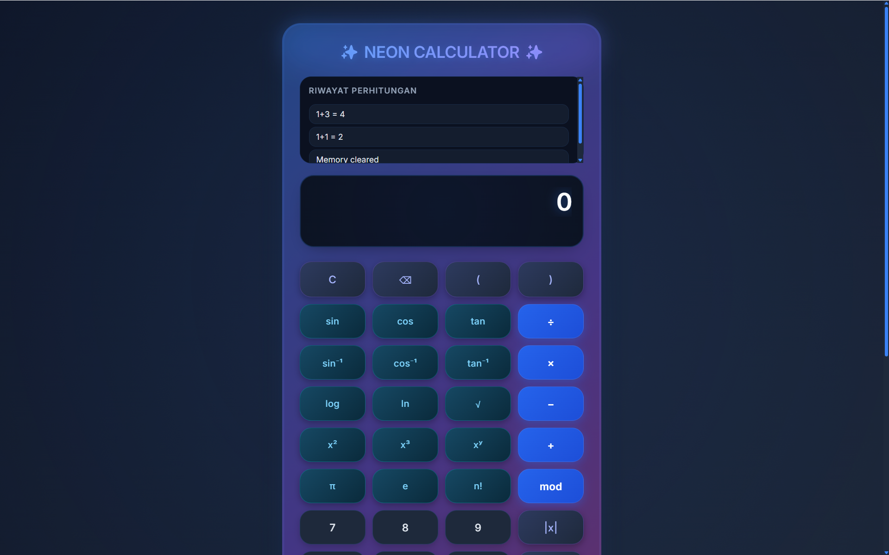

# Neon Calculator

A lightweight, client-side calculator web application with basic arithmetic and scientific functions.



## Features

- Basic arithmetic operations: addition, subtraction, multiplication, division.
- Scientific calculation mode: trigonometric functions (sin, cos, tan), square root, exponents, logarithms, and constants (pi, e).
- Calculation history log stored locally in the browser.
- Dark theme interface with neon glowing accents and responsive layout for mobile and desktop screens.
- Keyboard shortcuts for rapid data entry.

## Quick Start

Open `index.html` directly in any modern web browser, or serve it using a lightweight local server:

```bash
# Using Python
python -m http.server 8000

# Using Node.js
npx serve .
```

Navigate to `http://localhost:8000`.

## Keyboard Shortcuts

- `0` to `9`: Number input
- `+`, `-`, `*`, `/`: Operators
- `Enter` or `=`: Calculate result
- `Escape` or `c`: Clear display
- `Backspace`: Delete last character

## Tech Stack

- HTML5
- CSS3 (Flexbox, CSS Grid, Custom Properties)
- Vanilla JavaScript (ES6+)

## License

MIT License. See LICENSE file for details.
